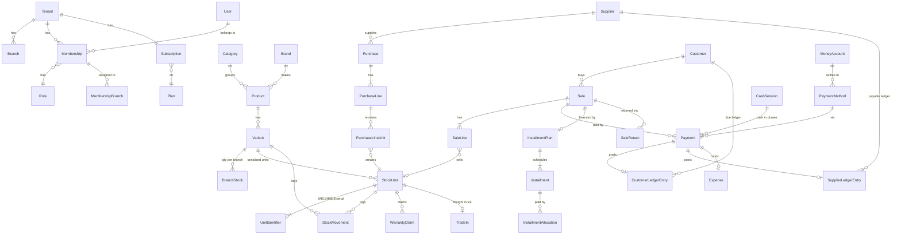

# 04 — Data Model

The full Prisma schema draft is in **[schema.draft.prisma](schema.draft.prisma)**. It's validated with Prisma 7.10 (`prisma validate`). When development starts, copy it to `prisma/schema.prisma` and evolve it with migrations from there ([12](12-dev-guide.md#database)). This document explains the model and the rules the schema alone can't express.

## Global conventions

| Rule | Detail |
|------|--------|
| IDs | `cuid()` strings. Auth tables use ids generated by Better Auth |
| Tenancy | Every tenant-owned model has `tenantId` + FK to `Tenant` (cascade on tenant hard-delete only). Every business unique includes `tenantId` |
| Money | `Int` paisa. Single values up to ৳21.4 million (2³¹−1 paisa) per row, which is well above any single mobile-shop document. Aggregates are computed in SQL (`SUM` returns bigint) and converted with `lib/money.ts` |
| Time | `DateTime` = UTC instant. `bizDate` (`@db.Date`) = the Asia/Dhaka calendar date of the business event, computed in the service layer when posting. All daily reports group by `bizDate` |
| Immutability | `Sale`, `Purchase`, `*Return`, `Payment`, ledger entries and `StockMovement` are never updated after posting, except the `status/void*` fields. `AuditLog` is append-only |
| Soft delete | Master data (Product, Variant, Customer, Supplier, Branch, PaymentMethod) uses `isActive/isArchived` flags. No hard deletes once referenced |
| Balances | Customer due, supplier payable, SMS credits and money-account balances are **always computed** from ledgers. `BranchStock.qty` is the only stored balance, and it's kept in sync with `StockMovement` in the same transaction |

## Entity map



## Model groups

| Group | Models | Used by (PRD module) |
|-------|--------|----------------------|
| Auth | User, Session, Account, Verification | M1 |
| Tenancy | Tenant, Branch, Role, Membership, MembershipBranch | M1, M10, M14 |
| Catalog | Category, Brand, Product, Variant, BranchPrice | M3 |
| Inventory | BranchStock, StockUnit, UnitIdentifier, StockMovement, StockAdjustment(+Line), StockTransfer(+Line), StockCount(+Line) | M4, M10 |
| Purchasing | Supplier, Purchase, PurchaseLine, PurchaseLineUnit, PurchaseReturn(+Line), PurchaseOrder(+Line), SupplierLedgerEntry | M5 |
| Sales | Customer, CustomerLedgerEntry, Sale, SaleLine, HeldCart, Quotation(+Line) | M6, M7 |
| After-sales | SaleReturn(+Line), WarrantyClaim(+Event), TradeIn | M9 |
| Installments | InstallmentPlan, Installment, InstallmentAllocation | M8 |
| Money | MoneyAccount, PaymentMethod, Payment, CashSession, ExpenseCategory, Expense | M6, M7, M11 |
| SMS | SmsTemplate, SmsMessage (also the outbox), SmsCreditEntry | M13 |
| System | DocumentCounter, AuditLog, Announcement | all, M15 |
| Billing | Plan, Subscription, BillingPayment | M15, [06](06-saas-billing.md) |

## Key modeling decisions

### Serialized vs quantity stock
- `Product.trackingType` decides how stock is tracked.
- **SERIALIZED:** each physical item is a `StockUnit` with its own `costPrice` and `status`. On-hand per branch = `COUNT(StockUnit WHERE status='IN_STOCK')`. A `SaleLine` for a serialized item has `qty = 1` and `unitId` set.
- **QUANTITY:** stock lives in `BranchStock(qty, avgCost)`. A `SaleLine` has `unitId = null`.
- Both kinds write `StockMovement` rows. For serialized items, one row per unit.

### Identifiers
`UnitIdentifier` holds IMEI1, IMEI2 and serial as separate rows with `@@unique([tenantId, value])`. This guarantees **no identifier is reused across units**, including the case where one unit's IMEI2 equals another unit's IMEI1. A scan looks up `UnitIdentifier.value` and returns the unit. Values are normalized before storing: IMEIs are digits only, serials are trimmed and uppercased.

### Payments and ledgers
- `Payment` is the single record of money moving (`direction` IN/OUT, `purpose`, `method`, optional `cashSession`).
- The customer/supplier ledgers record **obligations**. A sale with a due writes `CustomerLedgerEntry(SALE_DUE, +due)`. A collection writes `Payment(IN, DUE_COLLECTION)` + `CustomerLedgerEntry(COLLECTION, −amount, paymentId)`.
- Only the *unpaid* part of a sale goes to the ledger. Fully paid sales don't touch it.
- Money account balance = `openingBalance + Σ IN − Σ OUT` of payments through methods mapped to that account.

### Costing
- Serialized: `SaleLine.unitCost = StockUnit.costPrice` (specific identification).
- Quantity: on receipt, `newAvg = (qty·avg + inQty·inCost) / (qty + inQty)`, rounded to the nearest paisa. On sale, `SaleLine.unitCost = avgCost` at posting.
- Landed cost on purchase: `allocatable = otherCharges − discount`, split across lines by `lineTotal / subtotal`. The last line absorbs the rounding remainder.

### Discounts on returns
`SaleLine.invoiceDiscountShare` stores each line's share of the invoice-level discount at posting time, so returns refund the actually-paid amount and profit reports stay exact.

### Document numbers
`DocumentCounter(tenantId, branchId, docType, year)` is incremented with `UPDATE … RETURNING` inside the posting transaction. The format comes from settings, by default `{BRANCH}-{YY}-{seq:6}` for sales (`MN-26-000123`) with a different prefix per doc type (`P`, `SR`, `PR`, `TR`, `ADJ`, `WC`, `TI`, `Q`, `PO`, `RC`).

### Idempotency
`Sale`, `Purchase` and `Payment` carry `idempotencyKey` with `@@unique([tenantId, idempotencyKey])`. A retry with the same key returns the already-posted document instead of creating a duplicate.

## Constraints added in SQL migrations

Prisma can't express these. Add them in the first migration's SQL:

```sql
ALTER TABLE "BranchStock"  ADD CONSTRAINT branchstock_qty_nonneg  CHECK (qty >= 0 AND "reservedQty" >= 0 AND "reservedQty" <= qty);
ALTER TABLE "SaleLine"     ADD CONSTRAINT saleline_qty_pos        CHECK (qty > 0);
ALTER TABLE "SaleLine"     ADD CONSTRAINT saleline_serial_qty     CHECK ("unitId" IS NULL OR qty = 1);
ALTER TABLE "Payment"      ADD CONSTRAINT payment_amount_pos      CHECK (amount > 0);
ALTER TABLE "Variant"      ADD CONSTRAINT variant_prices_nonneg   CHECK ("salePrice" >= 0 AND ("minSalePrice" IS NULL OR "minSalePrice" <= "salePrice"));
ALTER TABLE "Role"         ADD CONSTRAINT role_discount_range     CHECK ("maxDiscountPct" BETWEEN 0 AND 100);
-- "A unit is sold at most once at a time" is enforced by the conditional status update in postSale
-- (UPDATE ... WHERE status IN ('IN_STOCK','RESERVED')), not by an index, because a returned unit can be sold again.
-- Fuzzy product/customer search:
CREATE EXTENSION IF NOT EXISTS pg_trgm;
CREATE INDEX customer_name_trgm ON "Customer" USING gin (name gin_trgm_ops);   -- requires pg_trgm
CREATE INDEX product_name_trgm  ON "Product"  USING gin (name gin_trgm_ops);
```

## Settings JSON (`Tenant.settings`)

Validated by a Zod schema in `features/settings/schemas.ts`. Missing keys fall back to these defaults:

```jsonc
{
  "locale": "bn",                     // default UI + invoice language
  "digits": "bn",                     // "bn" | "en" numerals in UI/print
  "invoice": {
    "paper": "80mm",                  // "80mm" | "58mm" | "A4"
    "showLogo": true,
    "footer": { "bn": "", "en": "" },
    "terms":  { "bn": "", "en": "" }, // warranty/return terms printed on invoice
    "showPreviousDue": true,
    "autoPrint": true
  },
  "numbering": { "sale": "{BRANCH}-{YY}-{SEQ6}" },
  "vat": { "enabled": false, "ratePct": 0, "inclusive": true },
  "sales": {
    "returnWindowDays": 7,
    "requireCashSession": true,
    "walkInAllowed": true,
    "heldCartHours": 24
  },
  "cash": { "differenceThreshold": 50000 },     // paisa (৳500)
  "installments": { "reminderDaysBefore": 1, "overdueReminderEveryDays": 3 },
  "sms": { "invoice": false, "dueReminder": false, "installmentReminder": true, "warrantyStatus": true, "senderMasking": null },
  "timezone": "Asia/Dhaka"
}
```

## Seed data

`prisma/seed.ts` creates:
- Plans STARTER / GROWTH / PRO ([06](06-saas-billing.md#plans))
- A platform admin user (from env `SEED_ADMIN_PHONE`, `SEED_ADMIN_PASSWORD`)
- **Demo tenant "Zobayer Smart Zone"**, with branch `MN` (Main, Ulipur), system roles Owner/Manager/Cashier, default payment methods (Cash, bKash, Nagad, Rocket, Card, Bank, Card EMI, Trade-in, Customer credit), money accounts, expense categories, categories (Smartphone, Feature Phone, Tablet, Smartwatch, Earbuds, Charger, Cable, Cover, Screen Protector, Power Bank, Memory Card), brands (Samsung, Xiaomi, Realme, Oppo, Vivo, Infinix, Tecno, Symphony, Walton, Nokia, Apple), sample products with variants, opening stock with valid-format demo IMEIs, sample customers and SMS templates in bn/en.

The seed must be **idempotent** (upserts by unique keys) and must never run in production except for plans and the admin user (`SEED_DEMO=false`).
